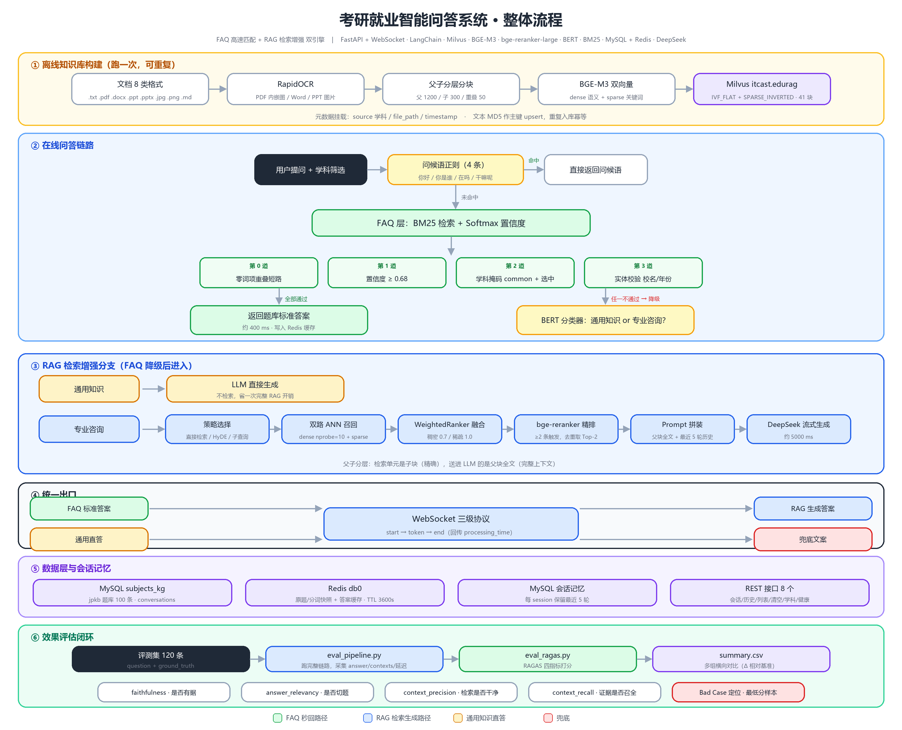
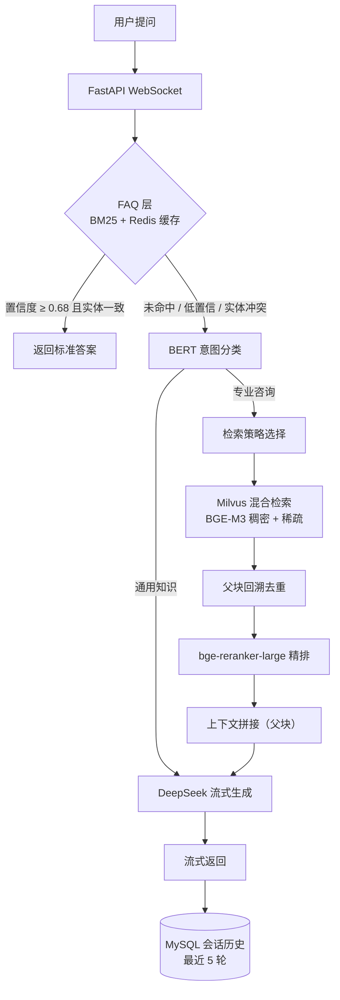

# EduRAG · 考研就业智能问答系统

> 基于 **FastAPI + Milvus** 的「FAQ + RAG 双引擎」校园咨询问答系统：高频问题毫秒级直出，专业问题走混合检索 → 精排 → 流式生成，内置 RAGAS 评测闭环。

[](https://www.python.org/)
[](https://fastapi.tiangolo.com/)
[](https://milvus.io/)
[](./LICENSE)

---

## 效果速览

| 指标 | 数值 | 口径 |
|---|---|---|
| FAQ 命中延迟（中位） | **538 ms** | exp_a4，22 题中 20 题命中 FAQ |
| 同题强制纯 RAG（中位） | **4,130 ms** | 同实验对照，加速 **7.67×** |
| 生成上下文字数 | 1,786 → **516 字（-71%）** | 父块 vs 子块作上下文 |
| 词召回 | 0.9715 → **0.9635** | 仅降 0.8% |
| RAGAS `faithfulness` | **0.797** | 72 题有效样本 |
| RAGAS `answer_relevancy` | **0.929** | 同上 |
| RAGAS `context_precision` | **0.882** | 同上 |
| RAGAS `context_recall` | **0.898** | 同上 |
| FAQ 护栏 | 拦 **4/4** 同模板误命中 | 100 条题库，正常样本零误杀 |

> 延迟为**中位数**，不是 P95 或吞吐量；评测集 100 题，28 题因 FAQ 命中或无检索上下文不计入 RAGAS。

---

## 为什么这样设计

通用大模型直接回答校园咨询，有两个绕不过去的问题：**知识滞后**（政策每年变）和**幻觉**（编造分数线、专业目录）。而纯 RAG 又太慢——每个「你好」都要走一遍检索 + 生成，4 秒起步。

所以这里做的是**分层降级**，而不是把所有问题都塞给大模型：

1. **高频问题不该进 RAG**。80% 的咨询是那 100 个问题反复问，用 BM25 + 缓存直出，成本接近 0；
2. **低频专业问题才值得检索**。进 RAG 前先用 BERT 分类，通用知识（"考研是什么"）直接交给大模型，只有专业咨询才触发向量检索；
3. **一旦检索，就要控制上下文成本**。子块检索、父块生成，把上下文从 1786 字压到 516 字，token 成本降 71% 而召回几乎不掉。

---

## 架构



文字版链路：



---

## 技术亮点

### 1. 三级应答链路 + 四道闸门

线上问答分三层，前一层能回答就不进下一层：

- **第 0 层｜问候语正则**（4 条）：`你好` / `你是谁` / `在吗` / `干嘛呢` 直接返回固定问候，连 BM25 都不走；
- **第 1 层｜FAQ 直出**：BM25 在 MySQL 题库 `jpkb` 中召回，Softmax 归一化后过**四道闸门**，全部通过才返回标准答案（约 400–600 ms）：
  1. **零词项重叠短路** —— 查询与命中题没有任何共同词，直接判不命中；
  2. **置信度 ≥ 0.68** —— 阈值不拍脑袋：在 100 条题库上标定，负样本最大置信度 0.673，取 0.68 保证负样本零误命中，正样本命中率 98%；
  3. **学科掩码** —— 命中题学科须为 `common` 或与用户当前选中学科一致；
  4. **实体校验** —— 校名、年份须与命中题一致。

  任一不通过即降级。第 3、4 道闸门拦住了 4 个「同模板不同学校」的误命中（4/4），100 条正常样本零误杀；
- **第 2 层｜RAG 生成**：先由 BERT 分类器判断「通用知识 / 专业咨询」——通用知识直接交大模型（省一次完整 RAG 检索），专业咨询才进检索链路。

### 2. 父子分层分块

父块约 1200 字、子块约 300 字、重叠 50 字。

- **检索单元是子块**：匹配集中在相关段落，避免长文档稀释相似度；
- **生成上下文是父块**：命中子块后回溯父块全文，避免上下文被切碎。

对比实验：以子块为上下文时，平均上下文从 1786 字降到 516 字（-71%），词召回从 0.9715 到 0.9635——**用 71% 的 token 换 0.8% 的召回损失**。

### 3. 稠密 + 稀疏混合检索

BGE-M3 同时产出稠密与稀疏两路表示，分别检索后用 `WeightedRanker` 融合：

- **稠密**：捕捉语义相似（"考研难不难" ↔ "研究生入学考试难度"）；
- **稀疏**：保住词项信号，对专有名词、年份、分数线这类**必须精确匹配**的内容更稳。

Milvus 索引：稠密 `IVF_FLAT`（`nlist=128`, `IP`），稀疏 `SPARSE_INVERTED_INDEX`（`IP`）。融合结果再过 `bge-reranker-large` 精排。

### 4. 幂等入库 + 多格式解析

8 类格式导入（TXT / PDF / Word / PPT / 图片 / Markdown 等），内嵌图片走 RapidOCR 取字。以**文本 MD5 为主键**做 Milvus `upsert`，同一份文档重复导入不会产生脏数据。

### 5. 评测闭环

不是"跑起来就行"。用 `kaoyan_qa_100.json`（100 题）建立评测基线，所有改动的收益都用数据说话：

- **RAGAS 四指标**（72 题有效样本）：`faithfulness` **0.797**｜`answer_relevancy` **0.929**｜`context_precision` **0.882**｜`context_recall` **0.898**；
- **延迟对照**（exp_a4，22 题）：FAQ 命中 20 题，中位 **538 ms** vs 同题强制纯 RAG **4,130 ms**，**7.67×**；
- **检索消融**：比对不同 k 值、是否重排、父子块策略；
- **方案选型**：对比 HyDE、子查询改写与直接检索，结论是**当前知识库规模下复杂改写不提升准确率、反而多 60% 耗时**，所以最终选择直接检索。

> 评测产物在 [`eval_runs/`](./eval_runs)（`summary.csv` 为多组汇总），评测脚本 `eval_pipeline.py` / `eval_ragas.py` 可复现。

---

## 快速开始

### 前置依赖

- Python 3.10+
- MySQL 8.0（FAQ 题库 `jpkb` + 会话历史）
- Redis 7（FAQ 快照缓存 + 答案缓存）
- Milvus 2.5（standalone 即可）

### 1. 安装

```bash
git clone https://github.com/baixiaomo666/edurag-qa.git
cd edurag-qa
pip install -r requirements.txt
```

### 2. 配置

```bash
cp config.example.ini config.ini
# 编辑 config.ini：填 MySQL / Redis / DeepSeek API Key
```

### 3. 准备数据

- FAQ 题库导入 MySQL 表 `jpkb`
- 知识库文档放入 `rag_qa/data/<学科目录>/`，然后执行离线入库：

```bash
python -m rag_qa.core.document_processor   # 解析 → 分块 → 向量化 → Milvus
```

### 4. 启动

```bash
python app.py
# 或
uvicorn app:app --host 0.0.0.0 --port 8080 --reload
```

浏览器打开 `http://localhost:8080` 即可对话。

---

## 项目结构

```
├── app.py                     # FastAPI 入口：REST + WebSocket 流式问答
├── faq_milvus.py              # 双引擎调度：FAQ 命中判断 → 降级 RAG
├── config.example.ini         # 配置模板（config.ini 不进仓库）
├── base/                      # 配置加载、通用工具
├── mysql_qa/                  # MySQL 层：FAQ 题库、会话历史
│   ├── db/                    # 连接池与 DAO
│   ├── retrieval/             # BM25 检索
│   └── cache/                 # Redis 快照缓存
├── rag_qa/
│   ├── core/                  # 文档处理：加载 → 分块 → 向量化 → 入库
│   ├── edu_document_loaders/  # 8 类格式加载器
│   ├── edu_text_spliter/      # 父子分块
│   ├── rag_assesment/         # RAGAS 评测
│   └── data/                  # 知识库语料（按学科组织）
├── eval_runs/                 # 评测产物（基线 + 消融实验）
├── static/                    # 前端页面
└── _exp_*.py                  # 离线实验脚本（不在线上链路中）
```

---

## Roadmap

- [x] FAQ + RAG 双引擎链路
- [x] 父子分块 + 混合检索 + 精排
- [x] RAGAS 评测闭环
- [ ] **LangGraph 图编排重构**：把 if-else 三级链路改为 StateGraph（router / faq / retrieval / generate / fallback）+ checkpointer 会话记忆 ← 进行中
- [ ] **Function Calling 工具层**：课表 / 分数线 / 就业数据查询，由模型自主选工具
- [ ] **Langfuse 可观测**：全链路 trace + Prompt 版本管理 + token 成本
- [ ] **MCP Server**：把检索能力封装为标准 MCP 工具，供任意客户端调用

---

## 说明

- 语料仅用于个人学习与课程研究，不含任何商业数据；
- 项目为个人独立开发，除文档加载与 OCR 使用开源组件外，检索链路、路由逻辑、评测脚本为自主实现。

## License

MIT
